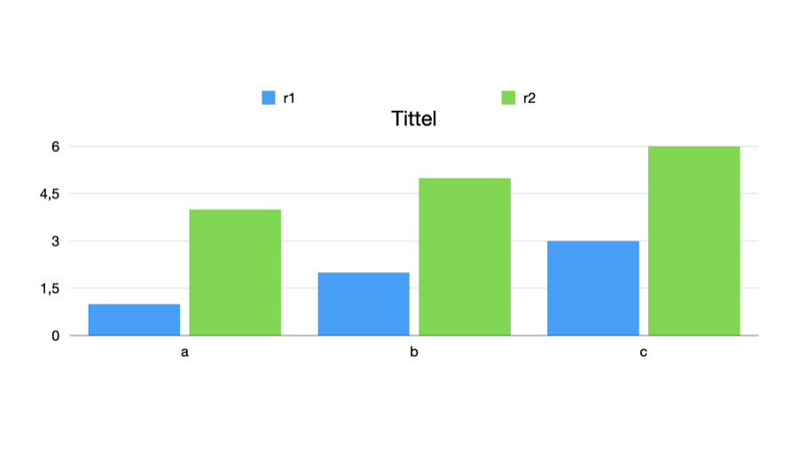

# 0298: Writing a chart's title and legend switches

**Status:** run

[0295](0295-chart-options.md) read a chart's title and legend switches from the Format sidebar's changes: fields 10000.21 and 10000.20 of the chart's type-5023 settings record. This experiment tests that reading from the other side, by writing the two fields into a file and letting Keynote show the result.

## Setup

| | |
| --- | --- |
| Keynote | 15.4 |
| macOS | 26.5.2 (25F84) |
| Date | 2026-11-10 |
| Input | `samples/0297/baseline.key`, a bar chart in the test theme with no title or legend |
| Writer | [`recipes/0298-chart-switches.py`](../recipes/0298-chart-switches.py), using the writer of [0287](0287-rewriting-a-document.md) |

## Recipe

```bash
mkdir -p samples/0298/images
cp samples/0297/baseline.key samples/0298/baseline.key
python3 -I recipes/0298-chart-switches.py samples/0298/baseline.key samples/0298/written.key title legend
```

The script follows the chart drawable's field 10000.10 to its settings record and sets 10000.21 = 1 and 10000.20 = 1, leaving everything else as it was. Keynote then opened `written.key` through AppleScript, exported the slide as a PNG image, and saved it again as `resaved.key`.

## Observation

Keynote opens the written file without a warning. The exported slide shows the chart with its title, `Tittel`, and a legend naming the two series, `r1` and `r2`:



In `resaved.key`, the settings record still holds 10000.20 = 1 and 10000.21 = 1, as written.

## Conclusion

Field 10000.21 of a chart's type-5023 settings record shows its title and 10000.20 its legend, read in [0295](0295-chart-options.md) and now produced by writing. Nothing else in the file needs to change for Keynote to draw them: the default title text and the legend entries come from the app and from the chart's data.

## Confidence

*Confirmed*: 10000.21 is the title switch and 10000.20 the legend switch.
