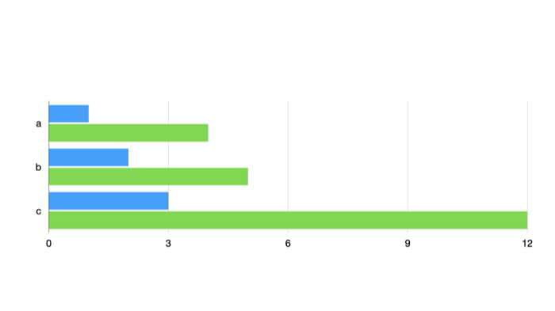

# 0317: Writing a chart's data and type

**Status:** run

A chart's data grid was read from field 10000.7 of its drawable (type 5021): row names in 7.1, column names in 7.2 and one 7.3 per row holding its values as doubles ([0067](0067-chart.md)); its type from 10000.1, 1 vertical bar and 2 horizontal bar ([0079](0079-pie-chart.md)–[0086](0086-chart-grouped-by-column.md)). AppleScript can't read a chart, so this experiment writes both and looks at the slide Keynote draws.

## Setup

| | |
| --- | --- |
| Keynote | 15.4 |
| macOS | 26.5.2 (25F84) |
| Date | 2026-11-10 |
| Input | `samples/0297/baseline.key`: a vertical bar chart, rows `r1` (1, 2, 3) and `r2` (4, 5, 6), columns `a`, `b`, `c`, in the test theme |
| Writer | [`recipes/0317-chart-data.py`](../recipes/0317-chart-data.py), using the writer of [0287](0287-rewriting-a-document.md) |

## Recipe

```bash
mkdir -p samples/0317/images-original samples/0317/images-written
cp samples/0297/baseline.key samples/0317/original.key
python3 -I recipes/0317-chart-data.py samples/0317/original.key samples/0317/written.key 1 2 12 2
```

The script sets the value in row 1, column 2 (counting from 0: `r2`, `c`) from 6 to 12, and the chart type from 1 to 2. Keynote opened each file on its own and exported its slide as a PNG image.

## Observation

The original draws vertical bars up to 6. The written file draws horizontal bars, with `r2`'s `c` bar at 12 and the value axis rescaled to 0–12:



## Conclusion

The chart's data grid and type work as read. Each value is a message whose field 1 is a double, rows run in 7.3 order and columns in each row's field order, and Keynote draws from the grid as written, scaling the axis to the data. Type 2 is a horizontal bar chart.

## Confidence

*Confirmed*: chart values in 10000.7.3 and the chart type in 10000.1, by writing them.
