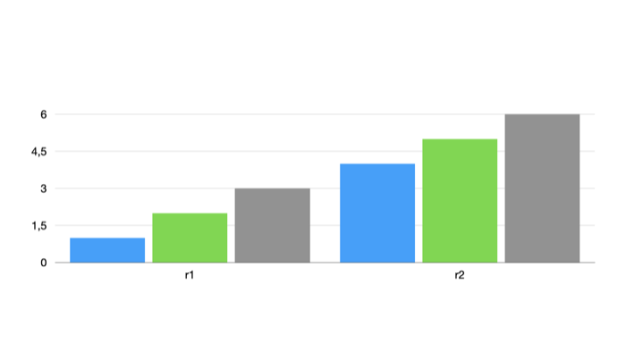

# 0350: Writing a chart's grouping

**Status:** run

A chart's field 10000.5 was read as its grouping into series: 1 by row, 2 by column, with the data grid the same either way ([0086](0086-chart-grouped-by-column.md)). This experiment writes 2 into a chart grouped by row and looks at the slide Keynote exports.

## Setup

| | |
| --- | --- |
| Keynote | 15.4 |
| macOS | 26.5.2 (25F84) |
| Date | 2026-11-10 |
| Input | `samples/0297/baseline.key`: a bar chart (record 2655552) with rows `r1` (1, 2, 3) and `r2` (4, 5, 6) and columns `a`, `b`, `c`, grouped by row, in the test theme |
| Writer | [`recipes/0302-set-path.py`](../recipes/0302-set-path.py) |

## Recipe

```bash
mkdir -p samples/0350/img-row samples/0350/img-col
cp samples/0297/baseline.key samples/0350/row.key
python3 -I recipes/0302-set-path.py samples/0350/row.key samples/0350/column.key 2655552 10000.5 varint 2
```

Keynote opened each file on its own and exported its slide as an image.

## Observation

Grouped by row, the chart shows categories `a`, `b` and `c` with two series, `r1` in blue and `r2` in green. With 10000.5 = 2 it shows categories `r1` and `r2` with three series, in blue, green and grey, the theme's first three series colours:



## Conclusion

Field 10000.5 = 2 makes the grid's columns the series and its rows the categories. The data grid is untouched, as [0086](0086-chart-grouped-by-column.md) found.

## Confidence

*Confirmed*: chart field 10000.5 is the grouping, by writing it.
