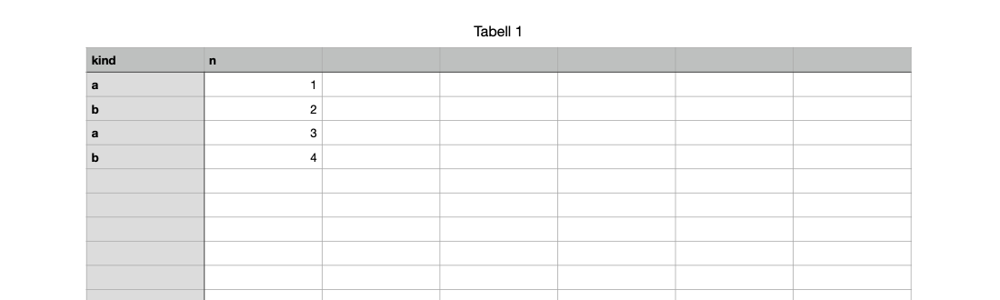

# Reading a Numbers table

This page decodes the cells of a small spreadsheet. It assumes the container layer from [Reading a Pages document](anatomy.md): parts, chunks, records and references are the same in all three apps.

The file is [kinds-and-numbers.numbers](../files/kinds-and-numbers.numbers), from experiment [0226](../../experiments/0226-category.md): a new spreadsheet whose first table has a header row `kind`, `n` and four rows below it.



## From the root to the table

| Step | Record | Where |
| --- | --- | --- |
| The document root, type 1. Field 1 lists the sheets. | object 1 | `Document.iwa` |
| A sheet, type 2. Field 2 lists its drawables: tables, text boxes, shapes. | | `Document.iwa` |
| A table's drawable, type 6000: position and size, and in field 2 the table model | 904769 | `CalculationEngine.iwa` |
| The table model, type 6001 | 904595 | `CalculationEngine.iwa` |
| A tile, type 6002: the cells | | `Tables/Tile.iwa` |

See [numbers.md](../../spec/numbers.md#from-the-root-to-a-tables-cells) for the full chain.

## The table model

Some top-level fields of the model:

<!-- include: numbers-model.txt -->

| Field | Value | Meaning |
| --- | --- | --- |
| 1 | UUID | The table's identity, used by formulas that refer to another table |
| 6, 7 | 22, 7 | Rows and columns: a new table's size, whatever is filled in |
| 8 | `Tabell 1` | The table's name (Numbers was set to Norwegian) |
| 9, 10 | 1, 1 | One header row and one header column |
| 12, 13 | 1, 1 | Header rows and columns are frozen |
| 22 | 1 | The name is shown above the table |

Field 4 is the table's storage. It names the lists that cells refer to by key:

<!-- include: numbers-storage.txt -->

| Field | Meaning |
| --- | --- |
| 4.1, 4.2 | The row and column header storage: sizes of rows and columns that aren't the default |
| 4.3 | The tiles. Each entry gives a tile index (4.3.1.1) and the tile (4.3.1.2, here a reference to object 904547). A tile holds 256 rows (4.3.2). |
| 4.4 | The string table, object 904552 |
| 4.22 | The format list |

## A tile's rows

A tile (type 6002) has one field-5 entry per row with content. Each entry gives the row index (5.1), a table of 16-bit little-endian offsets, one per column, with `ffff` for an empty cell (5.7, or 5.4 in a row with a single cell), and the cell bytes (5.6) ([text.md](../../spec/text.md#objects-in-the-text)). Here are the five rows, split into cells using the offsets:

<!-- include: numbers-rows.txt -->

Every cell starts with an 8-byte prefix and 4 bytes of flags. What follows depends on the flags.

## A number cell

Row 1, column 1 holds the number 1:

```
05 02 00 00 00 00 00 00   01 30 00 00   01 00 00 00 00 00 00 00 00 00 00 00 00 00 40 30   01 00 00 00   02 00 00 00
└ version, type 2 ┘       └ flags ┘     └ decimal128: 1 ──────────────────────────────┘   └ key 1 ┘     └ key 2 ┘
```

| Bytes | Meaning |
| --- | --- |
| `05` | Version 5 |
| `02` | Cell type 2, a number |
| `01 30 00 00` | Flags 0x3001: bit 0x0001 (a decimal128 follows), 0x1000 (a key into a list not yet identified) and 0x2000 (a key into the format list, for a number format) |
| 16 bytes | The value, an IEEE 754 decimal128, little-endian. The coefficient is in the low bits, here 1. The top two bytes `40 30` read as 0x3040 hold the sign (0) and the exponent 0x3040 >> 1 = 6176, which is the bias, so the exponent is 0. The value is 1 × 10⁰. |
| `01 00 00 00` | The key for flag 0x1000 |
| `02 00 00 00` | The key for flag 0x2000: format 2 |

The values and keys follow in the order of their flag bits. The flag table in [text.md](../../spec/text.md#objects-in-the-text) lists the bits found so far.

## A text cell

Row 1, column 0 holds `a`:

```
05 03 00 00 00 00 00 00   08 10 02 00   03 00 00 00   05 00 00 00   01 00 00 00
```

| Bytes | Meaning |
| --- | --- |
| `05 03` | Version 5, cell type 3, text |
| `08 10 02 00` | Flags 0x21008: 0x0008 (a string key), 0x1000, and 0x20000 (a key into the format list, for a text format) |
| `03 00 00 00` | String key 3 |
| `05 00 00 00` | The key for flag 0x1000 |
| `01 00 00 00` | Format 1 |

The text isn't in the cell. String key 3 is an entry in the string table, a type-6005 record in `Index/Tables/DataList-904552.iwa`:

<!-- include: numbers-strings.txt -->

Each entry in field 3 has its key (3.1), the number of cells using it (3.2) and the string as UTF-8 (3.3). `a` and `b` are each used by two cells, so equal texts share an entry. Rows 2 and 4 refer to key 4, `b`.

The two format keys lead to the format list, another type-6005 record, here in `DataList-904541.iwa`:

<!-- include: numbers-formats.txt -->

Key 1 is format kind 260, text, used by 6 cells: the two headers and the four letters. Key 2 is kind 256, a number, used by the four numbers ([text.md](../../spec/text.md#objects-in-the-text)).

## A reader's steps

1. From the model, read the rows and columns (6, 7) and the tiles (4.3).
2. For each tile, for each row entry: the table row is the tile index × 256 + the row index.
3. For each column whose offset isn't `ffff`, read the cell: type byte, flags, then the values and keys in flag order.
4. Look up strings in the string table (4.4) and formats in the format list (4.22).

Pages and Keynote tables are stored the same way, byte for byte ([0131](../../experiments/0131-pages-table-cells.md)).
