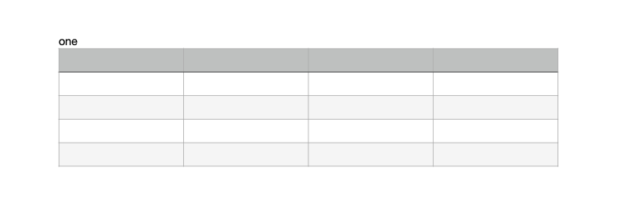
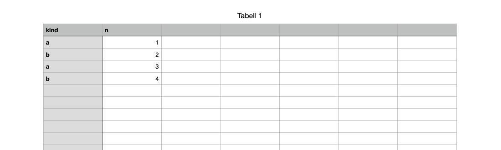

# Sample files

These documents were made for the experiments and are used as examples on this site. Each holds only text typed for the experiment: no images from Apple's templates and no personal details. They were saved by Pages and Numbers 15.4 on macOS 26.5, in Norwegian, so built-in names such as style names appear in Norwegian.

Open any of them with `iwork-probe` to follow along:

```bash
iwork-probe list hello.pages
iwork-probe records hello.pages Index/Document.iwa
iwork-probe text hello.pages
```

## Pages

### hello.pages

[Download](../files/hello.pages). A new blank document with the word `hello`, from [0002](../../experiments/0002-one-word.md). The smallest useful document: one paragraph in the Body style. [Reading a Pages document](anatomy.md) walks through it.


### two-paragraphs.pages

[Download](../files/two-paragraphs.pages). `one` and `two` as two paragraphs, from [0005](../../experiments/0005-paragraphs.md). The text holds U+000A between them, and the paragraph run table (field 5 of the body's text record) has an entry at 0 and one at 4.


### table.pages

[Download](../files/table.pages). A paragraph `one` and a table, from [0020](../../experiments/0020-a-table.md). The table is anchored in the text by an attachment character, U+FFFC, which points through a type-2003 attachment to a drawable and table model in `CalculationEngine.iwa`, as in Numbers.



### written-by-script.pages

[Download](../files/written-by-script.pages). Not saved by Pages: written by the Python writer from [0288](../../experiments/0288-writing-new-text.md), with new body text and no previews. Pages opens it as an ordinary document. See [Writing a document](writing.md).


## Numbers

### kinds-and-numbers.numbers

[Download](../files/kinds-and-numbers.numbers). A table with a header row `kind`, `n` and four rows of a letter and a number, from [0226](../../experiments/0226-category.md). [Reading a Numbers table](numbers-table.md) decodes its cells.



### written-cell.numbers

[Download](../files/written-cell.numbers). Written by script in [0290](../../experiments/0290-writing-a-cell.md): one cell's decimal128 replaced with 42.


## All fixtures

Each published document is a file of its own in [iwork-format-samples](https://github.com/alehel/iwork-format-samples), under the path the index gives it, and the Evidence table of each experiment links to its own and says what they show. To get many at once, take the zips. The fixtures are attached to the repository's [`fixtures` release](https://github.com/alehel/iwork-format/releases/tag/fixtures). To test a reader, start with the starter set: documents from the newest apps that together hold every field the project has seen them write. The other zips hold what each release saved, and can be unpacked into one folder.

| Zip | Documents | Size | What it holds |
| --- | --- | --- | --- |
| [`starter`](https://github.com/alehel/iwork-format/releases/download/fixtures/iwork-format-fixtures-starter.zip) | 257 | about 64 MB | From 16.0: a choice of the documents in the next zip, under the same paths |
| [`16.0`](https://github.com/alehel/iwork-format/releases/download/fixtures/iwork-format-fixtures-16.0.zip) | 436 | about 137 MB | Every document a recipe makes on its own, and samples 16.0 saved again |
| [`15.4`](https://github.com/alehel/iwork-format/releases/download/fixtures/iwork-format-fixtures-15.4.zip) | 1,009 | about 402 MB | The evidence: the documents of experiments 0001 to 0460, as the spec cites them |
| [`14.5`](https://github.com/alehel/iwork-format/releases/download/fixtures/iwork-format-fixtures-14.5.zip) | 99 | about 36 MB | The documents of the experiments with 14.5, and a choice of the recipes' documents made again |
| [`13.1`](https://github.com/alehel/iwork-format/releases/download/fixtures/iwork-format-fixtures-13.1.zip) | 51 | about 18 MB | A choice of the recipes' documents made again |

Inside them:

| Folder | What it holds |
| --- | --- |
| `NNNN/` | The documents of experiment NNNN, as the experiment made or wrote them: from 15.4 up to experiment 0460, and from the release it names after that |
| `keynote/NNNN/` | Keynote presentations made with the project's test theme instead of Basic White ([0292](../../experiments/0292-test-theme-reruns.md), and for 14.5 and 16.0 [0472](../../experiments/0472-keynote-16-0-with-the-test-theme.md) and [0474](../../experiments/0474-keynote-14-5-with-the-test-theme.md)) |
| `release/16.0/NNNN/` | Every document an experiment's recipe makes on its own, made again with 16.0, under the same names as the 15.4 ones ([0473](../../experiments/0473-every-scripted-sample-in-16-0.md)) |
| `release/14.5/NNNN/`, `release/13.1/NNNN/` | The same made with 14.5 and 13.1, cut down to documents that together hold every field path their sets hold ([0475](../../experiments/0475-every-scripted-sample-in-14-5.md), [0477](../../experiments/0477-every-scripted-sample-in-13-1.md)). `recipes/0473-release-set.py` makes the whole sets |
| `resaved/16.0/NNNN/` | Samples 16.0 opened and saved again, each beside its original (the index names it): features made by hand as 16.0 writes them, and what the app keeps of a document the spec's writer wrote ([0476](../../experiments/0476-resaving-every-sample.md), and [what saving changes](writing.md#what-the-app-changes-when-it-saves-your-document)) |

A document that is byte for byte another one's copy, such as the original a writing experiment started from, is in the zips once; the index lists the other names under [Copies](../../fixtures/INDEX.md#copies).

The [index](../../fixtures/INDEX.md) lists each file with its experiment, size, SHA-256, the release that saved it when that isn't 15.4, the original of a resaved copy and, for encrypted documents, the test password.

The Keynote presentations were made again with the project's own test theme, which replaces Basic White's photos with labelled test cards ([0291](../../experiments/0291-test-theme.md), [0292](../../experiments/0292-test-theme-reruns.md)). Left out are the few documents that hold Apple's theme photos or the placeholder text Apple wrote for a template. Folder packages are included as folders. Documents with comments, highlights or tracked changes record their author's name, here the project owner's. Every experiment's recipe says how to make its documents again with AppleScript.

What the project contributed to the fixtures is released under CC0; see [LICENSE.md](../../fixtures/LICENSE.md).
