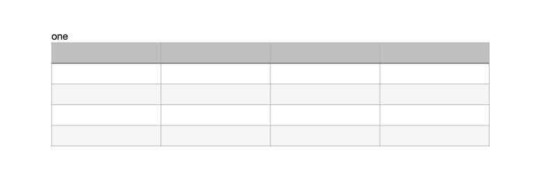
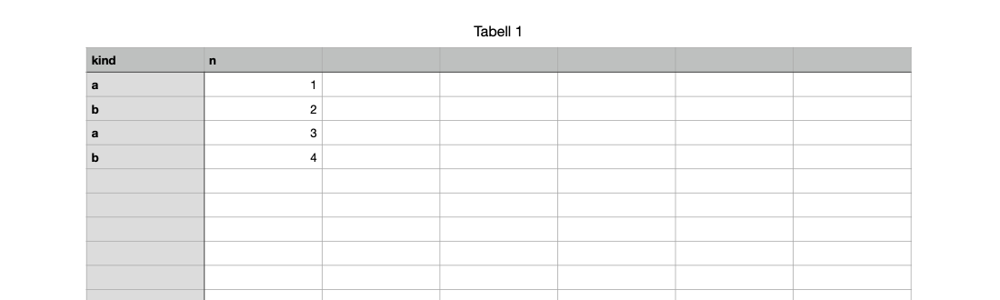

# Sample files

These documents were made for the experiments and are used as examples on this site. Each holds only text typed for the experiment: no images from Apple's templates and no personal details. They were saved by Pages and Numbers 15.4 on macOS 26.5, in Norwegian, so built-in names such as style names appear in Norwegian.

Open any of them with `iwork-probe` to follow along:

```bash
iwork-probe list hello.pages
iwork-probe records hello.pages Index/Document.iwa
iwork-probe text hello.pages
```

## Pages

### hello.pages

[Download](../files/hello.pages). A new blank document with the word `hello`, from [0002](../../experiments/0002-one-word.md). The smallest useful document: one paragraph in the Body style. [Reading a Pages document](anatomy.md) walks through it.


### two-paragraphs.pages

[Download](../files/two-paragraphs.pages). `one` and `two` as two paragraphs, from [0005](../../experiments/0005-paragraphs.md). The text holds U+000A between them, and the paragraph run table (field 5 of the body's text record) has an entry at 0 and one at 4.


### table.pages

[Download](../files/table.pages). A paragraph `one` and a table, from [0020](../../experiments/0020-a-table.md). The table is anchored in the text by an attachment character, U+FFFC, which points through a type-2003 attachment to a drawable and table model in `CalculationEngine.iwa`, as in Numbers.



### written-by-script.pages

[Download](../files/written-by-script.pages). Not saved by Pages: written by the Python writer from [0288](../../experiments/0288-writing-new-text.md), with new body text and no previews. Pages opens it as an ordinary document. See [Writing a document](writing.md).


## Numbers

### kinds-and-numbers.numbers

[Download](../files/kinds-and-numbers.numbers). A table with a header row `kind`, `n` and four rows of a letter and a number, from [0226](../../experiments/0226-category.md). [Reading a Numbers table](numbers-table.md) decodes its cells.



### written-cell.numbers

[Download](../files/written-cell.numbers). Written by script in [0290](../../experiments/0290-writing-a-cell.md): one cell's decimal128 replaced with 42.


## All fixtures

[Download all fixtures](https://github.com/alehel/iwork-format/releases/download/fixtures/iwork-format-fixtures.zip) (zip, about 117 MB): 462 documents from the experiments, from Pages, Numbers and Keynote. The [index](../../fixtures/INDEX.md) lists each file with its experiment, size, SHA-256 and, for encrypted documents, the test password.

The Keynote presentations were made again with the project's own test theme, which replaces Basic White's photos with labelled test cards ([0291](../../experiments/0291-test-theme.md), [0292](../../experiments/0292-test-theme-reruns.md)). Left out are documents made from Apple's templates, documents holding a personal name (tracked changes and comments record their author), folder packages,. Every experiment's recipe says how to make its documents again with AppleScript.

What the project contributed to the fixtures is released under CC0; see [LICENSE.md](../../fixtures/LICENSE.md).
