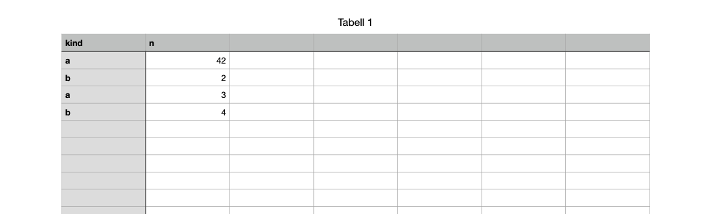

# Writing a document

A specification is tested best by writing from it. Experiments [0287](../../experiments/0287-rewriting-a-document.md) to [0290](../../experiments/0290-writing-a-cell.md) wrote documents with a small Python program built only from what the spec says, and opened the results in the apps. The program, [`recipes/0287-iwa-writer.py`](../../recipes/0287-iwa-writer.py), uses only the Python standard library.

## Re-encoding every part

The writer reads each `.iwa` part, decodes its chunks and records, and encodes them again:

1. Parse each record: the header length varint, the header, and the payloads whose lengths header field 2.3 gives.
2. Serialise each record again, recomputing field 2.3 from the payload's actual length.
3. Split the result into pieces of at most 65,536 bytes. Encode each as a raw Snappy block of literals only, without compression, and prefix it with a chunk header: `00` and the block's length as 24 bits, little-endian.
4. Write a ZIP with every entry stored.

A Snappy block of literals is a varint of the decoded length, then for each run a tag byte and the bytes themselves. A run longer than 60 bytes uses tag 60, 61 or 62 with a 1-, 2- or 3-byte length after it:

```python
def snappy_encode_literals(data):
    out = bytearray(write_varint(len(data)))
    for i in range(0, len(data), 65536):
        piece = data[i:i + 65536]
        n = len(piece) - 1
        if n < 60:
            out.append(n << 2)
        elif n < 1 << 8:
            out += bytes([60 << 2]) + n.to_bytes(1, "little")
        elif n < 1 << 16:
            out += bytes([61 << 2]) + n.to_bytes(2, "little")
        else:
            out += bytes([62 << 2]) + n.to_bytes(3, "little")
        out += piece
    return bytes(out)
```

Pages opened the re-encoded document, more than four times the size of the original (395 KB against 90), without a warning, and saved it normally. A writer doesn't need to compress ([0287](../../experiments/0287-rewriting-a-document.md)).

## New text

Setting field 3 of the body's type-2001 record to new text, and re-encoding, is enough for a one-paragraph body. Pages opened [written-by-script.pages](../files/written-by-script.pages), written without previews, and kept the record exactly as written when it saved it again ([0288](../../experiments/0288-writing-new-text.md)).


## Paragraphs need run entries

The run tables list positions in the text. When the text gains a paragraph, the paragraph run table (field 5) needs an entry at its start. Without it, Pages rebuilds the table on opening and gives every paragraph the stylesheet's default style, `paragraph-style-default`, instead of the style the writer named ([0289](../../experiments/0289-writing-two-paragraphs.md)). So writing `One` U+000A `Two` takes:

| Field | Written |
| --- | --- |
| 3 | `One\nTwo` |
| 5 | `{ 1: 0, 2: { 1: <Body style ID> } }`, `{ 1: 4 }` |

The second entry has no style; it continues the one before it.

## A new cell value

In Numbers, replacing the 16 bytes of a cell's decimal128 with another number is enough: Numbers opened [written-cell.numbers](../files/written-cell.numbers) and showed 42 where the original held 1. Nothing else in the file caches the value ([0290](../../experiments/0290-writing-a-cell.md)).

```python
old = (1).to_bytes(14, "little") + bytes([0x40, 0x30])   # 1 × 10⁰
new = (42).to_bytes(14, "little") + bytes([0x40, 0x30])  # 42 × 10⁰
```



## What a writer still has to get right

- Any change that adds objects needs new IDs that are unique in the document, and every reference listed in the record header (fields 2.4 and 2.5).
- Run tables must cover the new text: positions are in UTF-16 code units.
- Cells that add strings need string table entries, with use counts.
- The previews are optional; Pages makes new ones when it next saves.
